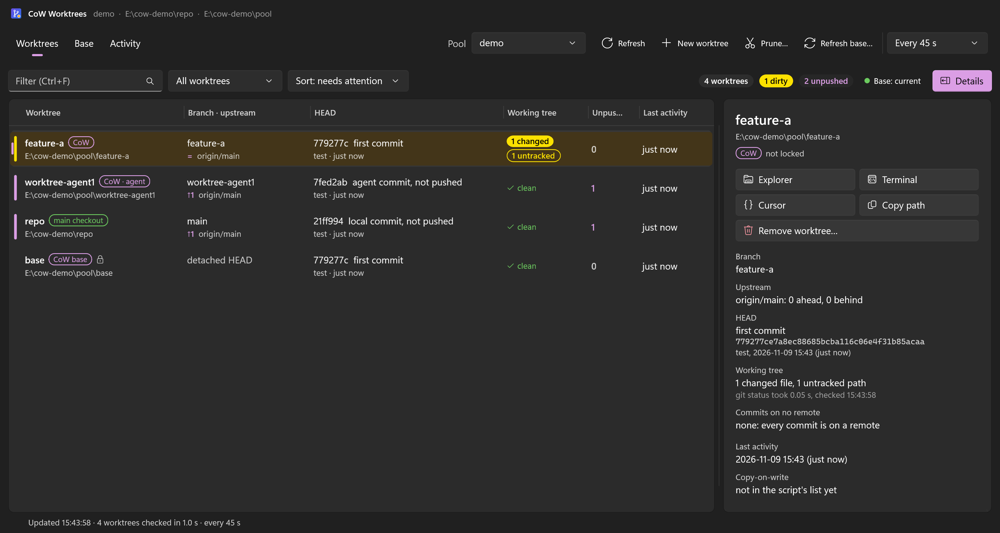
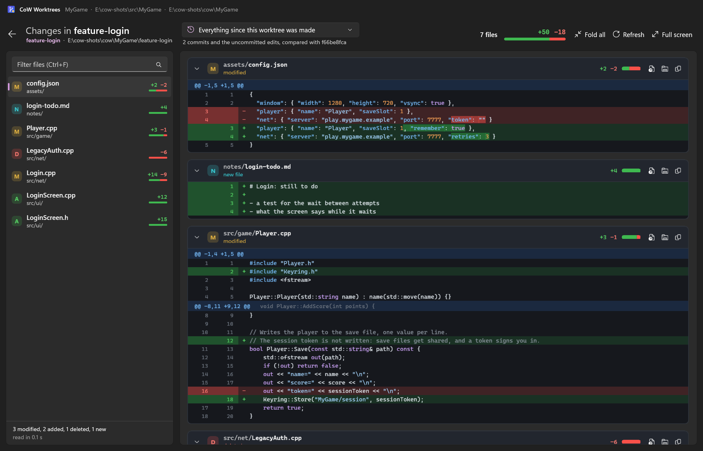
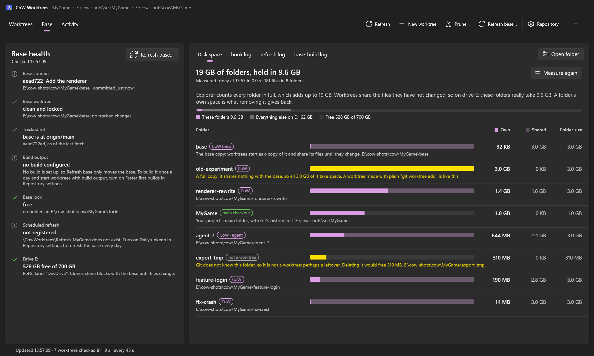
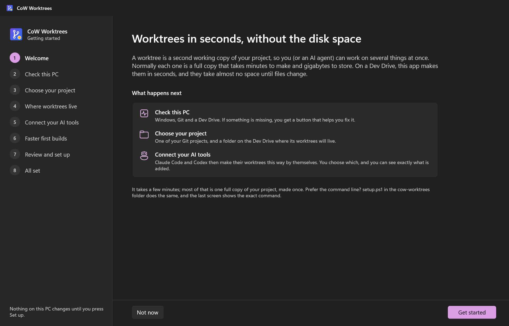
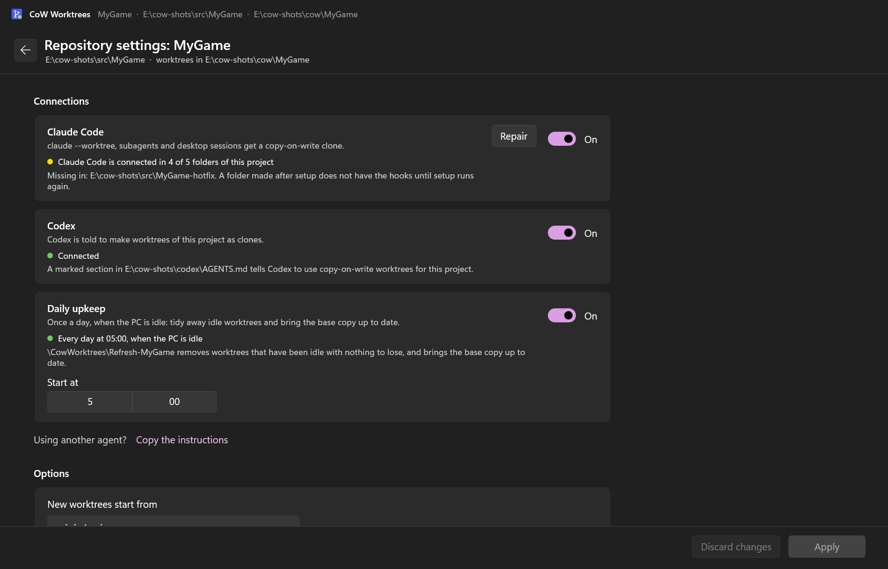

# cow-worktrees

**Git worktrees in seconds, at almost no disk cost, on Windows.** Each new worktree is a copy-on-write
clone of one prepared "base" worktree on a ReFS Dev Drive. Claude Code and Codex use it automatically,
and an app sets it all up, shows your worktrees and which ones have uncommitted work.

Built for big repositories, where every agent wanting its own worktree means another full checkout.
Measured on an 87 GB game repository (119k files, 56k of them in Git LFS):

| | `git worktree add` | cow-worktrees |
|---|---|---|
| New worktree | 9-10 min | ~30 s |
| Disk per worktree | ~87 GB | only the files you change |
| First build (MSBuild, at the base's commit) | 13-15 min, everything | 5 s, nothing to compile |



The app lists every worktree of a project with its branch, uncommitted work and unpushed commits. More
pictures are under [The app](#the-app).

## How it works

1. A **pool** belongs to one repository. It lives in a folder on a ReFS volume and holds a **base**
   worktree: one normal, full checkout, made once with plain Git and locked.
2. A new worktree is registered with `git worktree add --no-checkout`. Every file is then **block-cloned**
   from the base. On ReFS, a block clone shares the base's physical storage until either copy changes.
3. The base's **index is cloned too**, so Git trusts the cloned files without re-reading them
   (`core.checkStat=minimal` for that worktree only). Then Git switches to the branch you asked for and
   rewrites only the files that differ.
4. If the base has been **built**, the clone carries its build output. MSBuild's incremental-build state
   is rewritten to the new path, so the first build compiles nothing ("warm" clones).

Git does all the Git work, so `.gitattributes`, Git LFS, sparse rules and long paths behave exactly as in
any checkout. More detail: [docs/how-it-works.md](docs/how-it-works.md).

## Requirements

The app's walkthrough checks the first three and helps with each one that is missing.

- **Windows 11 24H2 or later.** From 24H2 onward, the Windows file copy function block-clones on ReFS.
  On an older Windows everything still works, but each worktree takes the full size of the repository;
  the walkthrough says so and opens Windows Update. `setup.ps1` tests block cloning on your volume.
- **Git for Windows 2.38+.** Git LFS works if your repository uses it. When Git is missing or too old,
  the walkthrough offers to install it with `winget`, or opens the download page.
- **A ReFS volume**, normally a [Dev Drive](https://learn.microsoft.com/windows/dev-drive/), with room
  for one full checkout plus build output. See [Creating a Dev Drive](#creating-a-dev-drive).
- **Windows PowerShell 5.1**, which comes with Windows; PowerShell 7 is not required.
- Optional: Claude Code and/or Codex, and an MSBuild build if you want warm clones.

## Quick start

1. **Download the installer.** Get `CowWorktrees-Setup-<version>.exe` from
   [Releases](https://github.com/elliotttate/cow-worktrees/releases).
2. **Run it.** The installer is not code signed, so Windows SmartScreen shows "Windows protected your
   PC": choose **More info**, then **Run anyway**. It installs for your user only, without administrator
   rights and without questions, into `%LOCALAPPDATA%\Programs\cow-worktrees`, adds a Start-menu
   shortcut ("CoW Worktrees") and starts the app.
3. **Follow the walkthrough.** On the first start with nothing set up, the app opens it by itself;
   after that it is behind **Get started** on the empty page. It checks this PC, asks for your project's
   folder and a folder on the Dev Drive, lets you choose what to connect (Claude Code, Codex, a daily
   upkeep task), and shows a summary. Nothing changes until you press **Set up**. Setup then makes the
   base, a full checkout once, which takes as long as a normal clone checkout.
4. **Make worktrees.** Press **New worktree** in the app, or start `claude --worktree` in your project
   (restart Claude Code sessions that were open during setup). The worktree appears under the folder you
   chose, for example `E:\cow\MyGame\my-feature`.

The app keeps itself up to date: once a day it looks for a newer release and shows a banner with an
**Update** button. More about the app: [The app](#the-app) and [gui/README.md](gui/README.md).

The Releases page has a second download, `cow-worktrees-<version>.zip`: the same scripts and the same app
in a folder, for people who would rather not run an installer. It is what the next sections use. A zip
copy does not update itself.

## Creating a Dev Drive

Go to Settings > System > Storage > Advanced storage settings > Disks & volumes > Create Dev Drive. A new
partition or a VHDX both work; Windows asks for 50 GB or more, and a dynamic VHDX only takes the space of
what is stored on it. Give it room for at least one checkout of your repository plus its build. In the
examples it is `E:`.

The walkthrough's "Check this PC" screen opens that Settings page for you and lists the steps beside
it; it looks again by itself when you come back to the app.

`scripts\new_dev_drive.ps1` makes a Dev Drive inside a virtual disk file from the command line. It is
experimental: it has been written but not yet run, so use the Settings route unless you want to try it
(`-WhatIf` prints what it would do and changes nothing). The app shows a button for it only when
`ExperimentalDevDrive` is `true` in `gui.json`.

## Prefer the command line?

Everything the app does is a PowerShell script, and every script can be run by hand. The app shows the
exact command for each action.

1. **Make a Dev Drive** as described above.
2. **Get the tool.** Download `cow-worktrees-<version>.zip` from
   [Releases](https://github.com/elliotttate/cow-worktrees/releases) and extract it somewhere permanent,
   for example `C:\Tools\cow-worktrees`. The hooks, the Codex section and the daily task point at this
   folder, so don't move it later. Then unblock the downloaded files:
   ```powershell
   Get-ChildItem C:\Tools\cow-worktrees -Recurse | Unblock-File
   ```
   If you used the installer instead, the same folder is at `%LOCALAPPDATA%\Programs\cow-worktrees`.
3. **Set up a pool for your repository.** Run this in Windows PowerShell:
   ```powershell
   cd C:\Tools\cow-worktrees
   .\setup.ps1 -Repo D:\src\MyGame -Root E:\cow\MyGame
   ```
   This makes the base, a full checkout once, which takes as long as a normal clone checkout. It then
   wires up Claude Code and Codex and schedules a daily cleanup. For warm builds, add a build command;
   see [Warm builds](#warm-builds-msbuild).
4. **Make worktrees.** From any checkout of the repository:
   ```powershell
   C:\Tools\cow-worktrees\scripts\cow_worktree.ps1 -Name my-feature -Branch my-feature -From HEAD
   ```
   The worktree appears at `E:\cow\MyGame\my-feature`.
5. **Watch them.** Run `app\CowWorktrees.exe` from the extracted folder. It needs no install.

Running `setup.ps1` again changes only what you pass: the name, base ref, branch prefix, prune age,
schedule time and each part of the build section keep the value they have. `-NoClaude`, `-NoCodex` and
`-NoSchedule` leave that piece out on a first run and remove it on a later one. Details:
[docs/configuration.md](docs/configuration.md#running-setup-again).

To check a machine before using it on a real repository, run `tests\e2e.ps1`. It sets up throwaway
repositories and pools, runs every feature, and removes it all again; 150 checks, about four
minutes.

## Using it from Claude Code

Setup adds hooks to `.claude\settings.local.json` in every checkout of the repository, the base and the
pool's worktrees included, so new clones inherit them. These files are local and never committed; if the
repository doesn't already ignore them, setup excludes them locally. **Restart open Claude Code
sessions** to load the hooks.

- **New worktrees become clones.** The `WorktreeCreate` hook takes over every worktree Claude Code makes:
  `claude --worktree`, the `EnterWorktree` tool, subagents with `isolation: "worktree"`, background
  sessions, workflow agents, and Claude Desktop's "worktree" sessions. Each one appears at
  `<root>\<name>` on branch `worktree-<name>`, starting at the commit of the session's checkout.
- **Removing.** The `WorktreeRemove` hook removes the worktree. It deletes the `worktree-<name>` branch
  only if it never got a commit.
- **Guard.** A `PreToolUse` hook stops agents from running `git worktree add` in the repository, and
  tells them to use the script instead. Text inside quotes doesn't count, and `COW_ALLOW=1` in a command
  lets it through.

Things to know:

- Claude Desktop doesn't tell the hook which branch you picked, so its worktree sessions start at the
  main checkout's commit.
- Claude Code never runs the remove hook for subagent worktrees, and archiving a desktop session may not
  either. The daily task prunes idle, clean ones after `pruneDays` (default 7).
- Claude Desktop gives a worktree session 5 minutes to start; a clone normally takes well under one.

The app's Repository settings show whether the hooks are in place, and switch them off and on. More:
[docs/claude-code.md](docs/claude-code.md).

## Using it from Codex

The Codex app has no hook for making worktrees. Setup writes a marked section into
`~\.codex\AGENTS.md` that tells Codex agents to use `cow_worktree.ps1` for this repository instead of
`git worktree add`. Worktrees that the Codex app creates itself are still full checkouts; you can point
its worktree folder at the Dev Drive under Settings > Worktrees. More: [docs/codex.md](docs/codex.md).

## Commands

All commands live in `scripts\`. Each one acts on one pool: `-Root` names it, or it is found from the
repository you run it in.

| Command | What it does |
|---|---|
| `cow_worktree.ps1 -Name x [-Branch b] [-From ref]` | New worktree at `<root>\x`. `-Branch` creates `b` at `-From`, or checks out an existing `b` as it is. The path is the last line of output. |
| `cow_worktree.ps1 -List [-Json]` | Worktrees in the pool, with idle days, changed and untracked files, own commits, unpushed commits |
| `cow_worktree.ps1 -Remove -Name x` | Plain `git worktree remove`: refuses if there are changes |
| `cow_worktree.ps1 -Prune [-OlderThanDays N] [-DryRun]` | Removes idle worktrees with nothing to lose: clean, not locked, no commits that exist nowhere else |
| `cow_worktree.ps1 -RefreshBase [-Fetch] [-Build]` | Moves the base to `baseRef` (fetching first) and rebuilds it |
| `migrate_worktree.ps1 -From <old> -Name x [-RemoveOld]` | Turns an existing full worktree into a clone, carrying every untracked and ignored file; see below |
| `register_refresh_task.ps1 [-At 05:00] [-Unregister]` | The daily prune-and-refresh task (setup does this) |
| `disconnect_all.ps1 [-Log]` | Runs `uninstall.ps1` (without `-RemovePool`) for every pool in `pools.json`. The installer's uninstaller uses it. |
| `new_dev_drive.ps1 -Path <file.vhdx> -SizeGB <n> [-Letter X] [-WhatIf]` | Experimental, not yet run: a Dev Drive inside a virtual disk file. Needs administrator rights. |

## Warm builds (MSBuild)

Give setup the build command, with `{config}` where the configuration goes:

```powershell
.\setup.ps1 -Repo D:\src\MyGame -Root E:\cow\MyGame `
    -BuildPrepare 'powershell -NoProfile -File tools\generate_projects.ps1' `
    -BuildCommand 'msbuild MyGame.sln /m /p:Configuration={config} /p:Platform=x64' `
    -BuildConfigs Debug,Release -BuildNow
```

In the app this is the "Faster first builds" screen of the walkthrough, and the section of the same name
in Repository settings; when the project folder holds a `.sln`, the walkthrough fills in an MSBuild
command for it.

The base is built at below-normal priority, and the daily task rebuilds it whenever the base moves.
Clones then build incrementally from the base's state. If your project files are generated, run the
generator in a new worktree before building, as in any fresh checkout. Details and caveats:
[docs/warm-builds.md](docs/warm-builds.md).

## Moving existing worktrees onto the Dev Drive

In the app, select a full worktree that lives outside the pool (its kind is `checkout`, `Codex` or
`Claude`) and choose **Move to copy-on-write**, in the details pane or from the right-click menu. The
dialog asks for a name, and whether to remove the old folder and leave a link in its place once the copy
has been checked. A move that stopped is picked up where it stopped when you choose it again.

The app runs `migrate_worktree.ps1`, which you can also run yourself:

```powershell
scripts\migrate_worktree.ps1 -From D:\src\MyGame-feature -Name feature             # copy + verify
scripts\migrate_worktree.ps1 -From D:\src\MyGame-feature -Name feature -RemoveOld  # verify again, retire the old one
```

`migrate_worktree.ps1` copies every untracked and ignored file (build output, local tools) plus modified
tracked files, then verifies Git status and every file's size, time and hash. Only then, with
`-RemoveOld`, does it remove the old worktree. If anything still has the folder open, it stops and
removes nothing. The old path becomes a junction to the new clone, so tools and notes that use it keep
working. Staged changes and sparse checkouts are refused, and so is the repository's main checkout.

## The app

CoW Worktrees is in the Start menu after the installer has run; in the zip it is `app\CowWorktrees.exe`.
It says "repository" where the scripts and these pages say "pool".

- **Getting started.** A walkthrough takes a PC from nothing to a working repository: it checks Windows,
  Git and the Dev Drive with a fix button for each missing item, then runs `setup.ps1` with your answers
  and shows its steps as a checklist. More > Add repository runs it again for another project.
- **Worktrees.** Every worktree of the repository, including ones outside the pool, with its branch,
  uncommitted changes, unpushed commits and idle time; dirty ones are highlighted. Create, remove, prune
  and move to copy-on-write from here.
- **Changes.** "View changes" on a worktree fills the window with what it changed: the files on the
  left, every changed line on the right in colour, for its uncommitted edits, for everything since it
  was made, or for one commit.
- **Summaries.** A worktree's details can carry a few lines written by Claude Code or Codex: what it
  is for, what was done, what is still open. On request, or kept up to date by itself when you turn
  that on.
- **Base.** The base's health: commit against `baseRef`, build state, locks, the daily task and the
  logs. Refresh the base from here. **Disk space** on the same tab measures what the folders really take
  on the drive, which Explorer cannot show: for each one its own space (what removing it gives back)
  against what it shares, and which ones are full copies.
- **Repository settings.** What is connected (Claude Code, Codex, the daily upkeep) as it really is on
  disk, with a switch and a Repair button for each; the options `setup.ps1` takes; and Remove. A banner
  with **Fix it** appears when a connection has gone missing or points at another copy of the tool.
- **Activity.** Every script run with its command line and its output. A running create, move, base
  build or first setup can be stopped, and is cleaned up or can be picked up later.

| | |
|:-:|:-:|
|  |  |
| **Changes**: every line a worktree changed, in colour | **Disk space**: what the folders really take on the drive |
|  |  |
| **Getting started**: from nothing to a working repository | **Repository settings**: what is connected, with a switch for each |

It is self-contained: nothing else has to be installed to run it. Setup, removal and every worktree
action go through the scripts above, and the app shows the command line of each one. Full description,
command-line options, tests and building: [gui/README.md](gui/README.md).

## Configuration

`setup.ps1` writes `<root>\cow-config.json` (repository, `baseRef`, branch prefix, build commands, prune
age, and which of Claude Code, Codex and the daily task it was asked to connect) and lists the pool in
`%LOCALAPPDATA%\cow-worktrees\pools.json`. Run setup again to change anything, or use the app's
Repository settings, which does the same. Reference: [docs/configuration.md](docs/configuration.md).

## Removing it

One repository: in the app, Repository settings > Remove. It runs `uninstall.ps1`, which you can run
yourself:

```powershell
.\uninstall.ps1 -Root E:\cow\MyGame               # hooks, Codex section, task, registry entry
.\uninstall.ps1 -Root E:\cow\MyGame -RemovePool   # ...and the base, once no other worktrees are left
```

Your project, its worktrees and its branches stay. `-RemovePool` is the box "Also delete the base copy"
in the app's dialog.

The tool itself: uninstall "CoW Worktrees" from Windows Settings > Apps > Installed apps. The
uninstaller first disconnects every repository (`scripts\disconnect_all.ps1`), so no hook, Codex
section or daily task is left pointing at scripts that are gone, then removes the installed files.
Worktrees, bases, each `cow-config.json` and `%LOCALAPPDATA%\cow-worktrees` stay, so a later install and
setup connects them again. Run the uninstaller with `/KEEPINTEGRATIONS` to remove the files only. A zip
copy has no uninstaller: run `scripts\disconnect_all.ps1`, then delete the folder.

## Safety

- The base is locked and must stay clean. Only `-RefreshBase` changes it, and every command checks it.
- Nothing ever runs `git worktree remove --force` on your work. The exceptions are the Claude Code remove
  hook, which removes only after Claude Code has decided to (it asks you when there are changes); a
  clone that failed halfway while it was being made; and a worktree whose only "changes" are files that
  merely look changed to Git (identical to the commit), with nothing untracked and no lock.
- The app adds no force of its own. Remove in the app is the script's plain `git worktree remove`. Its
  one use of `--force` is the script's case of a copy that was still being made: after you stop a
  create, a move or a first setup, it removes the partly made clone or base copy again, and only when
  that folder did not exist before the run. A move that had begun copying your files is kept instead.
- In the walkthrough nothing on the PC changes before you press Set up.
- The update check only reads the latest release. Nothing is downloaded or installed without a click,
  and a downloaded installer is started only when its SHA-256 equals the digest the release publishes.
- Branches are only ever deleted when they never got a commit.
- Every hook call and guard denial is logged to `<root>\hook.log`.

Problems: [docs/troubleshooting.md](docs/troubleshooting.md).

## Credits

- The base-plus-block-clone idea comes from [worktwin](https://github.com/rhagee/worktwin) and
  [git-cow-worktree](https://github.com/josharian/git-cow-worktree). This project adds the cloned index,
  so files are never rewritten or re-hashed, plus warm builds, the Claude Code and Codex wiring, and
  Windows long-path support.
- Notes from trying [Riftri](https://github.com/assistant-ui/riftri) on the same repository:
  [docs/riftri-notes.md](docs/riftri-notes.md).

## License

MIT. See [LICENSE](LICENSE).
