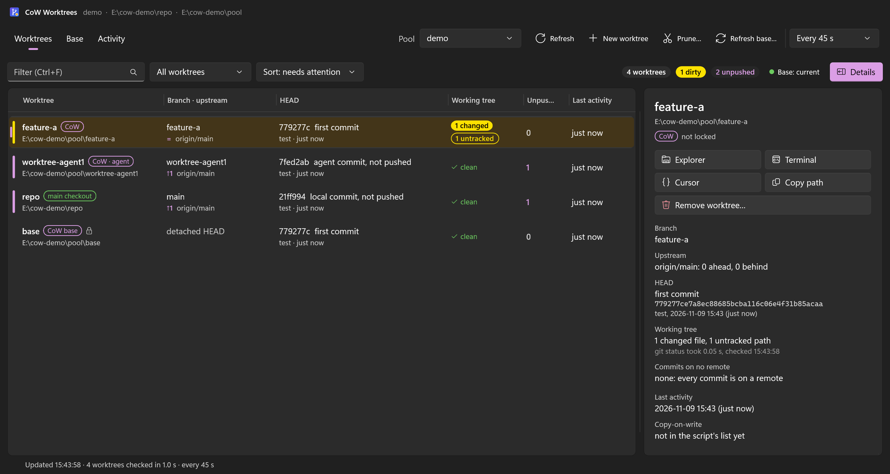
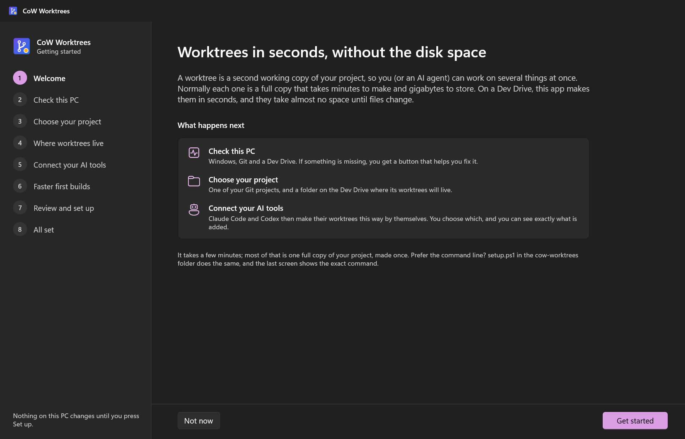
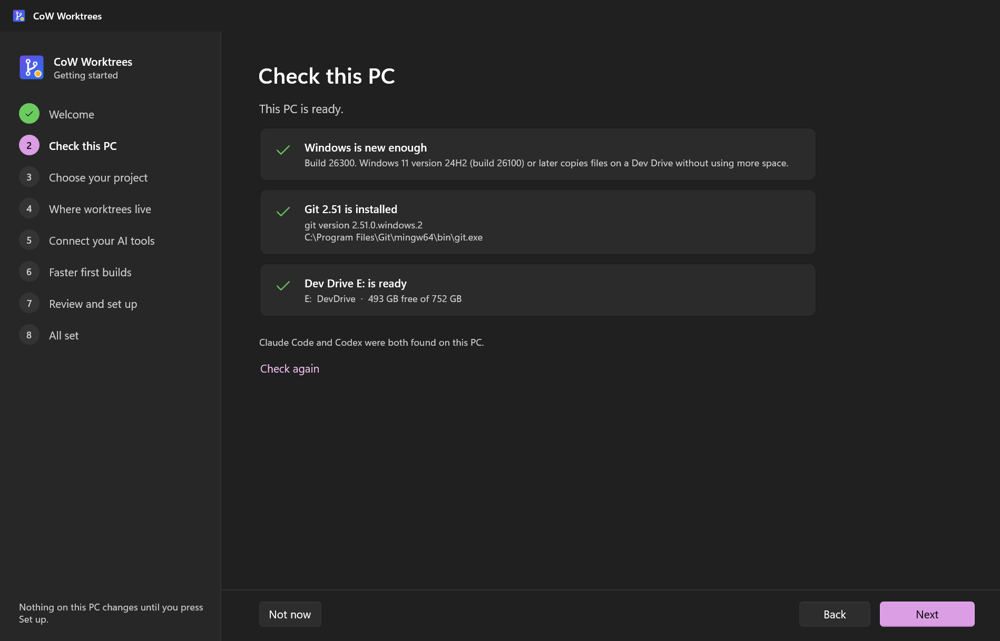
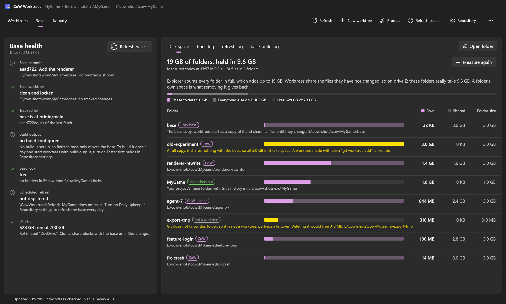
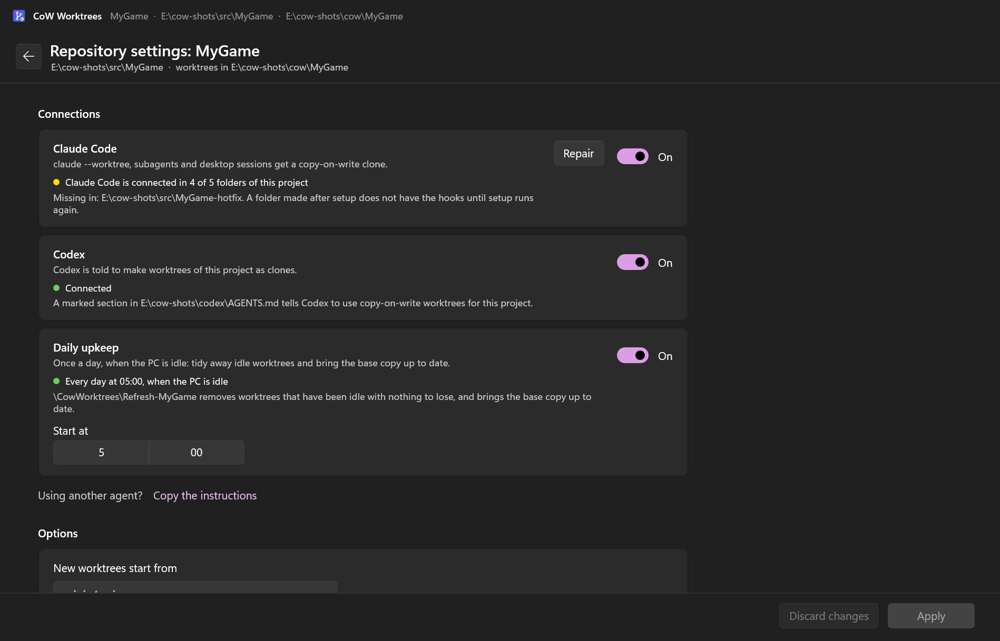
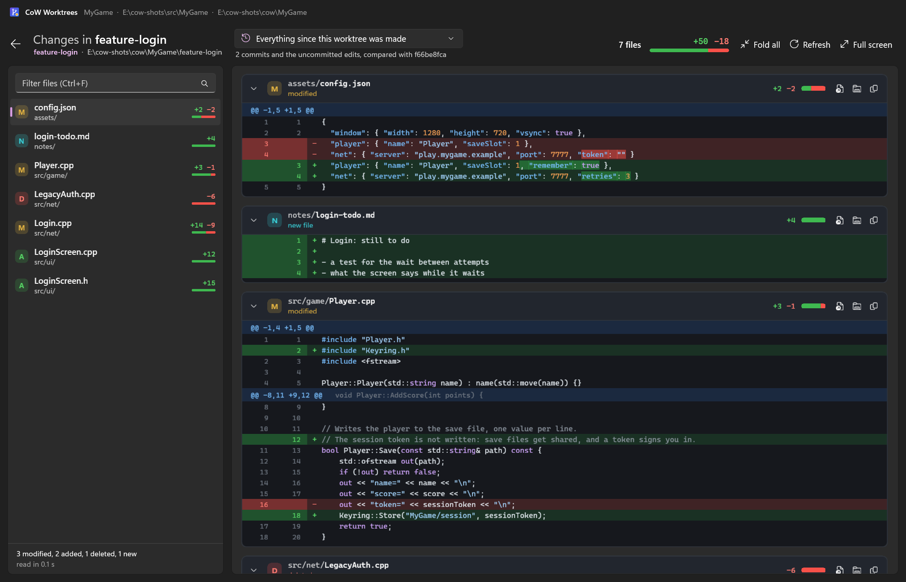
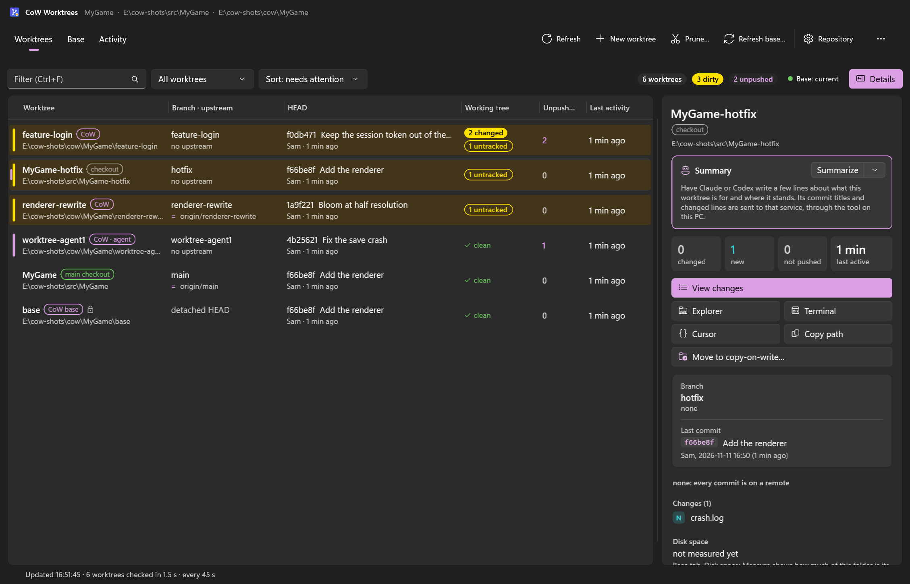

# CoW Worktrees (GUI)

A native Windows app (WinUI 3, Windows App SDK 1.8, C# / .NET 8) for **cow-worktrees**: Git worktrees made
as copy-on-write clones of a built base worktree on a ReFS Dev Drive. It walks a newcomer through getting
started, sets a repository up, connects Claude Code and Codex, and then shows every worktree of the
repository: which ones are dirty or hold commits that exist nowhere else, which ones could be pruned, and
whether the base that new worktrees are cloned from is current. It shows what each worktree changed, line
by line and in colour, with a summary by Claude or Codex if you want one, and what the folders really
take on the drive. It creates, removes, prunes and moves worktrees, refreshes the base, changes the setup
later and keeps itself up to date.

The app does not re-implement any of this. Setup, removal and every worktree action are the PowerShell
scripts of this repository, and the app shows the exact command line of each one before and while it runs
it. Whatever the app can do, PowerShell can do too.



## Repository and pool

The scripts and the other pages call one repository's copy-on-write setup a *pool*: a folder on a ReFS
volume holding the base worktree (`<root>\base`), the worktrees cloned from it, and `cow-config.json`. The
app says **repository** for the same thing, because "pool" means nothing on a first run. This page uses
the app's word, and "pool" only where a script or a file is meant.

`setup.ps1` lists the pools in `%LOCALAPPDATA%\cow-worktrees\pools.json` (the folder can be moved with
`COW_WORKTREES_HOME`):

```json
{ "version": 1, "toolDir": "C:\\tools\\cow-worktrees", "pools": [ { "name": "myrepo", "root": "E:\\pools\\myrepo" } ] }
```

The app reads that file and each pool's `<root>\cow-config.json` again at every refresh, so a repository
set up from PowerShell shows up without restarting. It writes neither file itself: the scripts it runs do.
With several repositories there is a picker in the toolbar; a repository whose folder or config is
missing gets a page that says what is wrong.

The scripts the app runs come from the cow-worktrees folder the app sits in (it walks up from the exe
looking for `setup.ps1` next to `scripts\cow_worktree.ps1`), else from `toolDir` in `pools.json`.

## Installing

`CowWorktrees-Setup-<version>.exe` from the Releases page installs for the current user only: no
administrator rights and no pages to click through, just a progress bar. It copies the tool to
`%LOCALAPPDATA%\Programs\cow-worktrees` (the same layout as the zip: `setup.ps1`, `scripts\`, `app\` and
so on), adds a Start-menu shortcut and starts the app. The installer is not code signed, so Windows
SmartScreen shows "Windows protected your PC": choose "More info", then "Run anyway".

| Installer switch | Effect |
|---|---|
| `/NOLAUNCH` | do not start the app at the end |
| `/NOICONS` | no Start-menu shortcut |
| `/DIR="<folder>"` | install somewhere else |
| `/VERYSILENT /SUPPRESSMSGBOXES` | no window at all (Inno Setup's own switches; the app's updater uses them) |

Uninstalling (Windows Settings > Apps > Installed apps) first runs `scripts\disconnect_all.ps1`, which
runs `uninstall.ps1` for every repository in `pools.json`: the Claude Code hooks, the Codex section, the
daily task and the entry in `pools.json` go, because they all point at scripts that are about to be
removed. Its output is appended to `disconnect.log` next to `pools.json`. Worktrees, bases, each
`cow-config.json` and `%LOCALAPPDATA%\cow-worktrees` stay. The uninstaller switch `/KEEPINTEGRATIONS`
skips the disconnecting and removes the files only.

The zip (`cow-worktrees-<version>.zip`) holds the same files without an installer; the app is
`app\CowWorktrees.exe` in it. A zip copy works the same except that it does not update itself, and the
walkthrough refuses to set up from a copy that sits in the temporary files folder, in Downloads, inside
the zip itself or on a removable or network drive: setup stores the folder's path in the hooks, the
Codex section and the daily task, so the folder has to stay where it is.

## Getting started

The walkthrough takes a PC from nothing to a working repository. It opens by itself on the first start
when nothing is set up, from **Get started** on the empty page, and from More > Add repository (which
skips the welcome screen when a repository already exists). One question per screen, Back and Next; Next
stays disabled until the screen is complete, and the reason is shown beside it. Nothing on the PC changes
until **Set up** is pressed on the review screen.



| Screen | What it does |
|---|---|
| Welcome | What a worktree is and what is about to happen. |
| Check this PC | Windows 11 24H2 or later (build 26100), Git 2.38 or later, and a Dev Drive (a ReFS volume), each with a button when it is missing; see below. Also says whether Claude Code and Codex were found. |
| Choose your project | A folder, typed or browsed to. Says whether it is a Git repository, its name and its branch, and why not when it cannot be used. When an extra worktree of a project is chosen, it offers the project's main folder instead. "New worktrees start from" is the branch the base follows; the suggestion is the remote's default branch, else the current branch's upstream, else the current branch, as in `setup.ps1`. |
| Where worktrees live | The Dev Drives with their free space, and a folder on one of them; the suggestion is `<drive>:\cow\<project>`. Says where the base copy will be. |
| Connect your AI tools | Three switches: Claude Code and Codex (on when found on this PC) and the daily upkeep with its start time. Each has "What exactly gets added" with the real file path. "Using another agent? Copy the instructions" puts the Codex text, filled in for this repository, on the clipboard. |
| Faster first builds | Optional and off. For MSBuild projects: when the project folder holds a `.sln`, a build command is filled in. See [docs/warm-builds.md](../docs/warm-builds.md). |
| Review, then set up | A summary in plain words; "Show details" holds the `setup.ps1` command. **Set up** runs it and shows its steps as a checklist that ticks off, with the raw output behind "Show details". |
| All set | **Create your first worktree** opens the New worktree dialog; `claude --worktree` to copy, with the reminder to restart open Claude Code sessions; a note on Codex. |



**Check this PC.** The screen looks again whenever the window becomes active, so coming back from
Windows Settings or an installer is enough; there is also a "Check again" link. Next needs Git and a Dev
Drive. An old Windows is a warning, not a stop: worktrees still work, but each takes the full size of the
project.

- Windows too old: **Open Windows Update**.
- Git missing or too old: **Install Git** starts `winget install --id Git.Git -e --source winget` in a
  console window you can see and answer (without `winget` it opens the download page), and **Download
  page** opens it directly. Git is looked for on `PATH` as the registry has it now and in Git's usual
  install folders, so a Git installed a minute ago is found without restarting the app.
- No Dev Drive: **Open disk settings** opens the Windows page for it, with four numbered steps beside the
  button. **Create one for me** runs `scripts\new_dev_drive.ps1` as administrator in its own console. That
  script is experimental: it has been written but not yet run, so the button is shown only when
  `ExperimentalDevDrive` is `true` in `gui.json`.

**While setup runs.** The checklist is `setup.ps1`'s own steps (its `==>` lines) in plain words:

| `setup.ps1` prints | The app shows |
|---|---|
| `Checking prerequisites` | Checking this PC |
| `Base worktree` | Making the base copy of your project |
| `Pool config` | Saving the settings |
| `Claude Code hooks` | Connecting Claude Code |
| `Codex instructions` | Connecting Codex |
| `Daily upkeep task` | Scheduling the daily upkeep |
| `Building the base (warm clones)` | Building the base copy |

Making the base copy is the one long step: a full checkout of the project. While it runs there is a
**Stop** button; stopping removes the partly made copy again. When setup fails, the screen explains the
known causes in plain words (not a Git repository, not a ReFS drive, a path that is too long, a base with
changed files and so on), always shows the script's own message under it, offers a button where there is
something to press, and turns Next into **Try again**. A message the app does not know is shown as it is.

## The main window

Three tabs, a toolbar (Refresh, New worktree, Prune, Refresh base, Repository, More), and up to three
banners above the page: a newer version, connections that need attention, and how the last run ended.

**Worktrees tab**: every entry of `git worktree list --porcelain` for the repository (the main checkout,
other checkouts, Codex and Claude Code worktrees, the pool's worktrees and its base), one row each:

| Column | Source |
|---|---|
| Worktree | folder name; kind (main checkout / CoW / CoW agent for `branchPrefix` branches / CoW base / Codex / Claude / checkout); lock icon; `prunable` when `-Prune` would remove it |
| Branch, upstream | branch or `detached HEAD`; ahead and behind counts against the upstream, `no upstream`, `upstream gone` |
| HEAD | short commit and subject, author and age |
| Working tree | changed and untracked counts (`git status --porcelain`), or `clean` |
| Unpushed | commits of HEAD on no remote (`git rev-list --count HEAD --not --remotes`); `no branch!` when HEAD is detached, since removing it would leave those commits only in the reflog |
| Last activity | latest of the folder, the worktree's index, HEAD and HEAD reflog, and every changed or untracked file |

Dirty rows are tinted with an orange bar; red = broken or commits at risk, blue = unpushed commits.

- **Files that only look changed.** A file committed as raw content while `.gitattributes` gives it a
  clean filter (Git LFS "files that should have been pointers", CRLF files under `text`) can show as
  modified in `git status` although it is identical to the commit. The app tests such entries the way the
  scripts do (the file's raw hash equals the blob in the index) and does not count them: the row stays
  clean, the details pane says "N files only look changed to Git", lists them after the real changes with
  a `~` mark, and Remove does not warn about them.
- **Columns**: drag a header edge to resize (the two columns beside it trade width, each keeps a minimum,
  the list always fills its width); double-click an edge to reset that pair; right-click the header to reset
  all. Click a header to sort by it, again to reverse; or use the Sort box ("needs attention" puts broken,
  at-risk, dirty and unpushed first).
- **Filtering**: the count chips (`3 dirty`, `1 unpushed`, `2 prunable`, `5 worktrees`) filter the list when
  clicked; the Filter box has the same choices plus copy-on-write / other checkouts; Ctrl+F searches by name,
  branch or path.
- **Details pane** (Ctrl+D hides it; drag its edge to resize; more under
  [The details pane and summaries](#the-details-pane-and-summaries)): a summary, full commit, upstream, the unpushed commits,
  the folder's own and shared disk space once it has been measured (see [Disk space](#disk-space)),
  the pool data from `cow_worktree.ps1 -List -Json` (commits since the worktree was made, start commit, why
  `-Prune` keeps it), its `git status` lines, and the buttons: Explorer, Terminal, editor, Copy path,
  **Move to copy-on-write** for a full worktree outside the pool, **Remove worktree** for one inside it.

**Base tab**: the base's commit against the repository's `baseRef` (behind / diverged, as of the last
fetch); whether the base is clean and locked; `base-build.json` against the base's commit (current, stale,
missing, or building now while `Global\cow-worktrees.build.<id>` is held); the lock files in
`<root>\.locks` (a live `refresh` holder means a refresh is moving the base); the scheduled task
`\CowWorktrees\Refresh-<name>`; free space on the pool's drive (warned below `fallbackMinFreeGB`, and when
it is not ReFS). The right side has four tabs: **Disk space** (below), which it opens on, and the tails
of `hook.log`, `refresh.log` and `base-build.log`.



**Activity tab**: every script run with its command line and output streamed live, and a **Stop** button
for the runs that can be stopped. A banner reports how each run ended, in plain words when it failed for
a known reason; after a create, a remove, a finished move, a setup or the removal of a repository that
you were watching, the app returns to the list.

**More menu**: Add repository (the walkthrough); how often the list refreshes (30 s to 5 min, or only
when you press Refresh); Check this PC (the walkthrough's checks in a dialog); App settings and About.

The window's position, size and monitor, the column widths, sort, filter and details pane are remembered.

### Disk space

On a Dev Drive a worktree shares the files it has not changed with the base, so folder sizes say little.
Explorer counts every folder in full: ten worktrees of a 100 GB project show as 1,000 GB while the drive
holds little more than 100. **Disk space**, the first tab on the right side of the Base tab (the picture
above), shows what is really there.

**Measure** looks at the base, at every other checkout of the repository that is on the pool's drive (the
project's main folder too, when it is there), and at every other folder directly inside the pool root.
For each one it shows:

| | |
|---|---|
| Own | The folder's own space: clusters that none of the other folders uses, which is what removing the folder gives back. The solid part of the bar. |
| Shared | Clusters it has in common with at least one of the other folders. They are on the drive once, however many folders have them. The pale part of the bar. |
| Folder size | Every file counted in full: what Explorer shows as the folder's size on disk. |

Above the list are the total ("506 GB of folders, held in 147 GB") and a bar for the drive: these
folders, everything else on it, and what is free. A folder's bar is as long as the folder is large next
to the largest one. The base comes first, then the folders by own space, largest first.

Some folders get a line in plain words:

- **A full copy**: a checkout with less than 1 % of itself in common with the base, so it takes its
  whole size. A worktree made with plain `git worktree add` is one, also when it sits inside the pool
  root, where the list shows it as `CoW`. For one outside the pool the line points to Move to
  copy-on-write. The project's main folder is a full copy by nature and is not flagged.
- **Not a worktree**: a folder in the pool root that Git does not know, for example what a removal that
  went wrong left behind. The line says what deleting it would free. The scripts' own `.locks` is left out.

Once a folder has been measured, a worktree's details pane has the same numbers under "Disk space", and
says "not measured yet" before.

How it measures: every file is asked where it sits on the volume (`FSCTL_GET_RETRIEVAL_POINTERS`, its
runs of clusters), the starts and ends of all runs are sorted, and the volume's cluster numbers are
walked once; a stretch only one folder uses is own, one that several use is shared.

- **It only reads.** A file is opened for its attributes alone, which changes nothing and works while
  something else has the file open.
- **It runs only when asked.** A refresh never measures. The last result is kept in
  `disk-space\<pool id>.json` next to `pools.json` and is there at once at the next start, with the time
  it was taken. When worktrees were made or folders removed since, a line says so. **Stop** ends a
  running measurement and leaves the numbers of the one before.
- **"Own" is own among the measured folders.** Clusters shared with a file outside them (a copy made in
  Explorer, another repository's pool on the same drive) are not seen, so such a folder's own space is
  overstated.
- **Files saved in the last seconds.** ReFS gives data its place on the drive when it is written out,
  some seconds after a program saved it. Until then the file has no clusters to compare. Such data is
  counted as the folder's own, which it will be; the folder's tooltip says how much of it there was.
- **What is left out.** Links (junctions and symbolic links) are not followed. Checkouts on another drive
  are not measured: they cannot share with the base. A checkout inside another one (Claude Code's
  `.claude\worktrees`) counts for itself, not for the folder around it. When files could not be asked
  where they sit (deleted meanwhile, no access), the view says how many.
- **A new worktree is not quite free.** Windows shares a cloned file in whole clusters (4 KB on a Dev
  Drive) and copies the rest: the last, partly filled cluster of every file is the clone's own. A
  worktree of a project with 120,000 files therefore starts with up to about 470 MB of its own, before
  anything in it was changed.
- **How long it takes.** On the PC this was written on, a real project's pool of 637,000 files in six
  folders (508 GB of folders, held in 147 GB) took 11 seconds, and a test pool of 240,000 small files
  about 3 seconds. A slower drive, or very large files in many fragments, take longer.

### What it runs

Every script is started as `powershell.exe -NoProfile -ExecutionPolicy Bypass -File <script> ...` under
Windows PowerShell 5.1, so downloaded files need no `Unblock-File` for the app. `cow_worktree.ps1` runs
from the repository with `-Root <pool root>` added.

| Action | Command | Confirmation |
|---|---|---|
| New worktree | `cow_worktree.ps1 -Name <n> [-Branch <b>] [-From <ref>]` | dialog with branch/ref suggestions; warns when the branch is checked out elsewhere |
| Remove | `cow_worktree.ps1 -Remove -Name <n>` (plain `git worktree remove`; the app adds no `--force`) | dialog listing changes, lock, unpushed / detached commits, recent activity |
| Prune | `cow_worktree.ps1 -Prune -OlderThanDays N -DryRun` first, then without `-DryRun` (N defaults to `pruneDays`) | the dry run's output; Prune is enabled only for the previewed day count |
| Refresh base | `cow_worktree.ps1 -RefreshBase -Fetch -Build`, or `-RefreshBase -Fetch` when the repository has no build | dialog; refuses to start a second one |
| Set up, Apply, Repair, Fix it | `setup.ps1 -Repo <repo> -Root <root> ...` | the review screen, or the settings page |
| Remove repository | `uninstall.ps1 -Root <root> [-RemovePool]` | dialog; the base copy is deleted only when its box is ticked |
| Move to copy-on-write | `scripts\migrate_worktree.ps1 -From <old> -Name <n> -Root <root>`, then again with `-RemoveOld` | dialog; see below |
| Open | Explorer, a terminal (Windows Terminal, else PowerShell), or an editor (VS Code, else Cursor) | none |

Remove is offered only for worktrees inside the pool root (not the base, not other checkouts).

| Key | Does |
|---|---|
| F5 | refresh now |
| Ctrl+N | new worktree |
| Ctrl+F / Esc | search the list / clear the search |
| Ctrl+D | show or hide the details pane |
| Ctrl+1 / 2 / 3 | Worktrees / Base / Activity |
| Enter, double-click | open the selected worktree in Explorer |
| Del | remove the selected copy-on-write worktree (asks first) |
| Ctrl+C | copy the selected worktree's path |
| Enter / Esc in the walkthrough | Next (from a field or a switch) / leave, asking first once something was entered |
| Esc in Repository settings | back to the worktrees, asking first when changes were not applied |

## Repository settings

The toolbar button **Repository** opens the settings of the repository that is shown.



**Connections.** One row each for Claude Code, Codex and the daily upkeep. A row shows what is on disk
right now, not what was asked for, and has a switch for what it should be:

| Connection | What the app looks at | States |
|---|---|---|
| Claude Code | this tool's hook entries in `.claude\settings.local.json` of every checkout of the repository that is on disk: the project's main folder, its other checkouts, the base and the pool's worktrees | Connected / Not connected / connected in some of the folders (the ones without are named) / Connected to another copy of the tool |
| Codex | the repository's marked section in the Codex instructions file (`COW_CODEX_AGENTS_FILE`, else `~\.codex\AGENTS.md`) | Connected / Not connected / Connected to another copy of the tool |
| Daily upkeep | the task `\CowWorktrees\Refresh-<name>`, its start time and what it starts | "Every day at HH:mm, when the PC is idle" / Off / Runs another copy of the tool; a task disabled in Task Scheduler is mentioned |

"Another copy of the tool" means the hook, section or task names scripts in a folder other than the one
this app runs from, for example a zip copy used before the installer. **Repair** appears on a row that is
half there or points elsewhere, and runs setup again with the saved choices. The switches start from
what `setup.ps1` recorded in `cow-config.json` (`integrations`); a repository set up by 1.0.x has no such
entry, so they start from what was found. The start time of the daily upkeep is beside its switch.
"Using another agent? Copy the instructions" is here too.

**Options.** The branch new worktrees start from (`baseRef`; it takes effect at the next refresh of the
base), the days before the daily upkeep removes an idle worktree (`pruneDays`; 0 = never), and the branch
prefix for the worktrees Claude Code asks for (`branchPrefix`).

**Faster first builds.** A switch, the build command, the configurations, and one optional command to
run before the build. A repository with several prepare commands keeps them as they are; they can only
be edited in `cow-config.json`. Switching the build off removes the build section (`-NoBuild`).

**Apply** runs `setup.ps1` again with every value on the page; "Show details" holds the command. The run
appears on the Activity tab, and the page reports "Saved" or the reason it did not work. Switching a
connection off and applying removes that piece: the hooks from every checkout, the Codex section, or the
task.

**Remove** disconnects Claude Code and Codex, removes the daily upkeep and takes the repository out of
the app (`uninstall.ps1`). The project, its worktrees and its branches stay. The box "Also delete the
base copy and this repository's folder on the Dev Drive" adds `-RemovePool`; the script refuses that
while worktrees still live next to the base, and the dialog says so beforehand.

**The banner.** "This repository's connections need attention" appears above the page when a connection
that should be there is gone (Claude Code not connected at all, the hooks missing from the project's main
folder or from the base, the Codex section or the daily task missing), or when one points at another copy
of the tool. **Fix it** runs setup again with the saved settings. A checkout that some tool made after
setup has no hooks until setup runs again; that shows on the settings page, without a banner.

## Installed again? Setups from before

A setup lives on the Dev Drive: the folder with `cow-config.json`, the base and the worktrees. The app's
list of repositories lives in the app's own folder. When the app is installed again, or that folder is
lost, the setups are still there. The walkthrough's first screen looks for them (two folder levels deep
on every ReFS drive; it reads folder names and each `cow-config.json`, nothing else) and lists those
that are not in the app: name, folder, project and number of worktrees. **Use them** runs `setup.ps1`
again for each ticked one with the choices its settings record, which adds it to the app and points
Claude Code, Codex and the daily upkeep at this copy of the tool. Nothing is copied or built and no
worktree is touched. A setup whose project folder is gone is listed with the reason and cannot be
ticked. "Get started" below it sets up another project as before.

## The details pane and summaries

Selecting a worktree shows it on the right: its name, kind and folder; a **Summary** card; four numbers
(changed files, new files, commits that are on no remote, time since the last activity); the buttons;
the branch and last commit; then the commits that are on no remote and the changed files, one row each.
A commit's row opens the Changes view on that commit, a file's row opens it at that file. Below them:
the folder's disk space as last measured on the Base tab, and for a copy-on-write worktree where it
started and whether pruning would remove it.

**Summarize** has Claude or Codex write a few lines about the worktree: one sentence on what it is for,
two to five points on what was done, and an "Open:" line when something is unfinished. The arrow next
to the button chooses the tool (the button itself uses the one chosen last), copies the summary or
removes it. It is written only when you press the button, unless you turn on the option at the end of
this list.

- **What is sent.** The worktree's name and branch, its commit titles, the list of changed files with
  their line counts, and excerpts of the changed lines (about 60,000 characters at most): the work since
  the worktree was made, or for other checkouts what is not on the upstream branch. It goes to
  Anthropic or OpenAI through the tool as it is set up and signed in on this PC, and counts against
  that account like any other use of it.
- **How it runs.** `claude -p` with `--tools ""` (no file or shell tools), or `codex exec` with
  `--sandbox read-only`, in an empty folder of the app's own (`summary-work` next to `pools.json`), with
  the text on standard input. The tool cannot change the worktree and does not look at it itself.
- **Where it is kept.** `summaries.json` next to `pools.json`. When the worktree's commit or its count of
  changed or new files differs from when the summary was written, the card says the worktree has
  changed since; **Update** writes a new one. `ClaudeModel` (default `haiku`) and `CodexModel` (default:
  the one Codex is set up with) in that file name the model.
- **Keep every worktree's summary up to date** (in the arrow's menu; off until you turn it on). After
  each look at the worktrees, every one that has work of its own (changed or new files, or commits of its
  own) and no summary of its present state gets one, one at a time, with the tool chosen last. A worktree
  is left alone until two minutes after its last activity, so one that is being worked on is not
  summarised at every step; the base and worktrees without work get none. Each summary sends that
  worktree's commit titles and changed lines as above, so this option uses the account without asking
  each time. A summary that fails is not tried again until the worktree changes, and after three
  failures in a row the option rests until the app is started again.
- A tool that is not installed, not signed in, or refuses its model answers in its own words in the card.

## Changes

**View changes** (the button at the top of a worktree's details, the right-click menu, or Ctrl+Shift+D)
fills the window with what changed in the selected worktree. It works on every row: copy-on-write
worktrees, plain checkouts and the project's main folder.



- **The box at the top** chooses what is compared: *Uncommitted changes* (edits and new files that are
  not in a commit yet), *Everything since this worktree was made* (its commits and its uncommitted edits
  together; for a worktree without a recorded start it is everything that is not on its upstream branch,
  or not on the repository's base ref), or one of its commits. A worktree with nothing uncommitted opens
  on everything since it was made.
- **On the left**, the changed files: a coloured letter (M modified, A added, D deleted, R renamed, N a
  new file Git does not track yet, ! in conflict), lines added and removed, and a small bar of their
  proportion. Type in the filter to narrow the list. Choosing a file scrolls to it; scrolling the lines
  moves the selection along.
- **On the right**, every changed line: green for added, red for removed, three unchanged lines around
  them, old and new line numbers, the changed part of a line marked, and the code coloured (comments,
  strings, numbers, keywords). Each file's header folds it and has buttons to open the file, show it in
  Explorer and copy its path or its changes as a patch.
- **Keys:** Esc back, F5 read again, F11 whole screen, Ctrl+F filter, J and K (or Alt+Down, Alt+Up)
  next and previous file.

It only reads. Git runs with `--no-optional-locks`, as everywhere in the app, so looking never takes
`index.lock` in a folder an agent is working in. When the worktree changes while the view is open, a
line at the top offers to read it again. Limits keep a huge change from filling memory: 6,000 changed
lines are read per file and 200,000 in all, 2,000 new files are listed, new files over 768 KB and binary
files get a note instead of lines, and a file shows its first 1,500 lines until "Show them" is pressed.
With more than 150 files the list opens folded. Files that only look changed to Git (see above) are
listed last, marked with ≈, and are not counted.

## Moving a worktree to copy-on-write

A full worktree outside the pool (kind `checkout`, `Codex` or `Claude`; never the project's main folder)
has **Move to copy-on-write** in its details pane and its right-click menu. The dialog asks for the name
of the new clone and has one box, ticked: "When the copy has been checked, remove the old folder and
leave a link in its place". It warns when the worktree was active in the last 15 minutes.



- The first run (`migrate_worktree.ps1` without `-RemoveOld`) makes a clone of the same commit, carries
  over changed, untracked and ignored files, and compares the copy with the original. Nothing in the old
  folder is changed.
- With the box ticked, a second run (`-RemoveOld`) follows when the first succeeded: it checks again,
  removes the old folder and leaves a junction at the old path, so editors, terminals and sessions that
  remember it keep working. If something still has the old folder open, nothing is removed.
- Without the box the old folder stays. Choosing Move to copy-on-write on it again later finishes the
  job: the dialog recognises the clone an earlier run left under that name (the script records
  `cow.migrateFrom` and `cow.migrateState` in it) and either picks the copy up where it stopped or, when
  it was already checked, offers only "Remove the old folder". Any other folder of that name is refused.

## Stopping a job, and closing the window

**Stop** is on the Activity tab (and on the walkthrough's setup screen). It is offered only where
stopping leaves something that is cleaned up or can be picked up; it ends the script and everything the
script started.

| Job | Stop is offered | What is left |
|---|---|---|
| New worktree | for the whole run | The partly made worktree is removed again. One that had already finished is kept. |
| Move to copy-on-write | during the first run (copy and check) | Nothing in the old folder has changed. A clone that had begun copying is kept, and the next move picks it up; one that had not is removed again. |
| Removing the old folder (the second run of a move) | never | |
| Refresh base | once the base has moved and only its build is left | The base is where it should be, without build output until the next build finishes. |
| Setup | while the base copy is being made, when this run is the one making it | The partly made base copy is removed again; nothing else had changed yet. |
| Remove, Prune, Remove repository | never | |

The clean-up after a stop only ever touches a folder that did not exist when the run started. When it
cannot remove the folder, the last line of the run gives the Git command that does.

**Closing the window while a job runs** asks first. "Close the window" hides it; the job carries on,
because the script reports to the app, and the app exits by itself when the last job has ended. Starting
the app again brings the hidden window back.

**One window per person.** A second start of the app brings the first window to the front instead of
opening another. (Hidden and unattended runs, as the tests use them, take no part in this.)

## Updates

Once a day at most, after the first refresh, the app reads the latest release of this project from
GitHub (`api.github.com/repos/elliotttate/cow-worktrees/releases/latest`). That is all the check does. A
newer version shows a banner: "Version x.y.z is available", with **Update**, **What's new** (the release
page) and **Skip this version**. Closing the banner means "later": it is back after the next daily check.

**Update** works in an installed copy only (the installer leaves a file `installed.marker` in the tool
folder to say so). It

1. does not start while a job or a refresh of a base is running: it says so, and you try again when
   they have finished;
2. downloads `CowWorktrees-Setup-<version>.exe` into `%LOCALAPPDATA%\cow-worktrees\updates`. Only the
   release asset with exactly that name, from this project's release downloads, is ever taken;
3. computes the file's SHA-256 and compares it with the digest GitHub publishes for the asset. When the
   release has no digest, or the two differ, the file is deleted, the banner says the update could not be
   verified, and the button becomes **Get the update**, which opens the release page;
4. starts the installer with `/VERYSILENT /SUPPRESSMSGBOXES` and closes. The installer waits for the app
   to be gone, replaces the files and starts the app again.

A zip copy does not update itself: its banner has **Get the update**, which opens the release page. Draft
releases and pre-releases are never offered. The first start of a newer version shows "Updated to version
x.y.z" once.

The check is off when "Look for a new version once a day" is switched off in App settings
(`CheckForUpdates` in `gui.json`), when the environment variable `COW_NO_UPDATE_CHECK` is `1`, and in
every hidden or unattended run. A check that fails (no network, GitHub unreachable) writes one line to
`gui.log` and shows nothing. "Check now" in App settings checks at once and ignores a skipped version.

The updater is tested against a stand-in release served from the same PC
(`gui\tests\update_selftest.ps1`), where the downloaded file is verified but never started. Updating from
a real GitHub release has been run once by hand, from 1.1.0 to 1.2.0 with the Update button: the check,
the download, the checksum, the silent install and the restart worked, and the repositories, their
Claude Code hooks and their daily tasks were as before.

## App settings and About

More > App settings and About shows the version, the folder the scripts run from, and whether this is an
installed copy (updates itself) or a portable one (from the zip). It has the update switch with "Check
now", the editor for "Open in editor", "Open the log folder" and a link to the website.

Settings are in `gui.json` next to `pools.json` (`%LOCALAPPDATA%\cow-worktrees\gui.json`), written by the
app:

| Key | Default | Set from |
|---|---|---|
| `SelectedPool` | the repository shown last | the repository picker |
| `RefreshIntervalSeconds` | `45` (0 = only when you press Refresh) | More > Refresh the list |
| `MaxParallelGit` | `4` | the file only |
| `EditorPath` | empty = VS Code if installed, else Cursor | App settings |
| `CheckForUpdates` | `true` | App settings |
| `LastUpdateCheck` | none | the app (time of the last daily check, UTC) |
| `SkippedVersion` | empty | "Skip this version" on the update banner; empty it to see that version again |
| `LastRunVersion` | empty | the app (for the "Updated to" note) |
| `ExperimentalDevDrive` | `false` | the file only; `true` shows "Create one for me" on Check this PC |
| `WalkthroughOffered` | `false` | the app, once the walkthrough has opened by itself |
| `ColumnWeights`, `DetailsWidth`, `DetailsVisible`, `Sort`, `SortReversed`, `Filter`, `WindowBounds`, `WindowMaximized` | view state | the window |

Unexpected errors, and one line per script run, go to `gui.log` in the same folder.

## Staying out of the way

- Every git call runs with `--no-optional-locks` (and `GIT_OPTIONAL_LOCKS=0`), so polling never takes
  `index.lock` in a worktree an agent is committing in and never rewrites its index. The same variable is set
  for `cow_worktree.ps1 -List -Json`, so polling does not reset the idle time `-Prune` goes by.
- At most `MaxParallelGit` (default 4) git processes at once, all off the UI thread.
- The list refreshes every 45 s by default (30 s to 5 min, or off) and on F5; rows update in place.

## Requirements

- Windows 10 1809 or later, or Windows 11, x64, to run the app. Copy-on-write itself needs Windows 11
  24H2 and a ReFS volume; the walkthrough checks both.
- Git for Windows, and Windows PowerShell 5.1 (part of Windows) for the scripts.
- The release build is fully self-contained: the .NET 8 runtime and the Windows App SDK runtime are next to
  `CowWorktrees.exe`, so nothing else needs to be installed.

## Command line

For unattended checks, tests and screenshots. A run with `--snapshot`, `--dump`, `--selftest-checks`,
`--run-setup` or `--update-result` is *unattended*: it never writes `gui.json`, never looks for updates
and never opens the walkthrough by itself.

| Option | Effect |
|---|---|
| `--pool <name or root>` | show that repository first |
| `--hidden` | window off-screen, out of the taskbar, never activated; no update check, and no part in "one window per person" |
| `--snapshot <png>` | after the first full refresh, render the window to a PNG |
| `--dump <json>` | after the first full refresh, write what every row and health item shows, and the last Disk space measurement (`diskSpace`; `null` when there is none) |
| `--tab worktrees\|base\|activity`, `--select <name>` | what the snapshot shows. `--tab base:hook` (or `refresh`, `build`, `disk`) also picks the tab on the right side of the Base tab |
| `--measure [stop[:ms]]` | before the snapshot or dump, measure the disk space of the repository shown and keep the result, as the Measure button does. With `stop`, press Stop at once, or that many milliseconds after the start. Read only in an unattended run. |
| `--size 1100x700` | window size in layout pixels |
| `--theme light\|dark` | start in that theme instead of the one Windows is set to |
| `--drag 2:-140` | before the snapshot, drag the header edge after column 2 by -140 pixels (same code path as the mouse) |
| `--sort Activity[:2]` | before the snapshot, click that column header (twice reverses) |
| `--exit` | quit afterwards |
| `--wizard [step]` | open the walkthrough on that screen: `welcome` (the default), `checks`, `project`, `location`, `tools`, `builds`, `review`, `done`. Without `--snapshot` or `--dump` it opens and stays, which is what the UI Automation test drives. |
| `--wizard-state <json>` | answers to fill in before the snapshot: `repo`, `root`, `baseRef`, `claude`, `codex`, `schedule`, `buildCommand`, and `autoStart` (with `--wizard review`: press Set up and wait for it to end). Read only in an unattended run. |
| `--settings` | open Repository settings before the snapshot. Read only in an unattended run. |
| `--changes [scope]` | open the Changes view on the `--select` worktree: `uncommitted`, `all`, or the start of a commit's name; without a scope the view picks. Without `--snapshot` or `--dump` it opens and stays. |
| `--changes-file <path>` | bring the file whose path ends with this to the top of the Changes view before the snapshot |
| `--summarize <claude\|codex>` | have that tool write the summary of the `--select` worktree before the snapshot. `COW_CLAUDE_CLI` and `COW_CODEX_CLI` name a stand-in for the tool (the tests use them). |
| `--found-dump <out.json>` | write the setups from before that the walkthrough's first screen found. `COW_SCAN_ROOTS` (folders, separated by semicolons) replaces the drives it looks on; the tests use it so that real setups are never listed. |
| `--wizard-adopt` | press "Use them" on that screen: this really runs setup for each one found |
| `--refresh-again` | look at the worktrees a second time before `--dump`, as the timer would; the dump's `seconds`, `rowsSeconds` and `scriptSkipped` are then the second look's |
| `--summary-dump <out.json>` | write what the details pane holds: the summary, the numbers, the commit and file rows |
| `--changes-dump <out.json>` | write what the Changes view holds (the scopes, each file's kind, counts and lines), then quit with `--exit` |
| `--selftest-checks <out.json>` | write what Check this PC finds, the tool folder, whether it is an installed copy and the version, then quit |
| `--run-setup <options.json>` | run a setup, a removal, a move or a create through the same code as the walkthrough, Repository settings and the dialogs, write the outcome, then quit. This really does what it is asked. |
| `--fake-checks <json>` | **only with `--hidden`.** Replace results of Check this PC: `windows`, `git`, `devDrive` (`ok`, `missing`, `tooOld`), `drives` (`letter`, `label`, `freeGB`, `totalGB`), `claude`, `codex` |
| `--update-feed <url>` | **only with `--hidden`.** A stand-in for the GitHub address; only `http://127.0.0.1` or `http://localhost` is accepted. Used by `--update-result`. |
| `--update-result <out.json>` | **only with `--hidden`** (it needs `--update-feed`). Check the test feed, download and verify, and write what would have happened, then quit. The downloaded file is never started. |

The options file of `--run-setup` holds one of four objects, and optionally `result` and `stop`:

| Object | Keys | Runs |
|---|---|---|
| `setup` | `repo`, `root`, `name`, `baseRef`, `claude`, `codex`, `schedule`, `scheduleAt`, `buildCommand`, `buildConfigs`, `buildPrepare`, `noBuild`, `pruneDays`, `branchPrefix`, `buildNow` | `setup.ps1` |
| `uninstall` | `root`, `removePool` | `uninstall.ps1` |
| `migrate` | `from`, `name`, `retire` | Move to copy-on-write, and with `retire` the removal of the old folder after it |
| `create` | `name`, `branch`, `from`, `stopAfterMs` (press Stop that long after the start) | New worktree |

`"stop": true` presses Stop as soon as the run allows it. Without `result` the outcome goes next to the
options file as `<name>.result.json`: the runs with how each ended, the command line, exit code, steps,
the plain-words error if any, the output, and the repositories and connections afterwards. `migrate` and
`create` work on the repository the app shows (`--pool`).

Three environment variables keep a run away from the real setup; the tests that set a repository up or
install the app set all three: `COW_WORKTREES_HOME` (the folder of `pools.json`, `gui.json`, `gui.log`,
`updates\` and `disk-space\`), `COW_CODEX_AGENTS_FILE` (the Codex instructions file) and
`COW_NO_UPDATE_CHECK=1`.

## Tests

They run the published app, so run `gui\build.ps1` first. The first three and the installer test keep
the registry of repositories, the Codex file and the settings in temporary folders, and the two that
set a repository up remove its scheduled task again. `disk_space.ps1` builds a throwaway pool of its
own on the Dev Drive, registry included, and deletes it afterwards. `ui_create_remove.ps1` and
`compare_status.ps1` work on a pool you name: the first makes and removes one worktree of its own, the
second only reads.
Run each with `powershell -NoProfile -ExecutionPolicy Bypass -File <script> ...` from the repository's
top folder.

| Script | What it checks | How to run |
|---|---|---|
| `gui\tests\setup_runner.ps1` | The app sets a repository up and removes it again the way the walkthrough does (`--run-setup`), on a throwaway repository whose path has a space: the registry, the locked base, the hooks, the Codex section and the task; a setup on a drive that is not ReFS fails with the plain-words reason; a second run with Codex and the daily task off removes exactly those; a full worktree is moved to copy-on-write and its old path becomes a junction, with an untracked and an edited file carried over; a create that is stopped leaves nothing behind; removal with `-RemovePool` leaves nothing behind. | `[-Exe <exe>] [-Drive E]`; needs a Dev Drive |
| `gui\tests\ui_setup_wizard.ps1` | Through UI Automation, hidden: every screen of the walkthrough to "You're all set", then the same things as above and that the main window shows the repository; in Repository settings, Codex off and Apply removes the section and keeps the hooks; with the hooks file deleted by hand the banner appears and Fix it puts them back; a full worktree is moved through the Move to copy-on-write dialog, its old folder becomes a junction, and its untracked file and branch are in the clone; App settings and About opens; Remove takes away the registry entry, hooks, section and task and leaves the base copy. | `[-Exe <exe>] [-Drive E] [-CaptureDir <folder>]`; needs a Dev Drive |
| `gui\tests\changes_view.ps1` | The Changes view on a throwaway repository under `%TEMP%` with every kind of change: the files it lists, what happened to each, the counts, the lines and the marked words, for uncommitted edits, for all work on a branch and for single commits; a file that only looks changed; a clean worktree. `-Shots <folder>` also saves a picture in each theme. | `gui\tests\changes_view.ps1 [-Exe <CowWorktrees.exe>]` |
| `gui\tests\summary_view.ps1` | The summary and the details pane's rows, with stand-ins for Claude and Codex so nothing is sent anywhere: what the tool is given and how it is run, the headline, points and "Open:" line read from its answer, saving and showing again, "changed since", a failing tool and a missing tool. `-Shots <folder>` also saves pictures. | `gui\tests\summary_view.ps1 [-Exe <CowWorktrees.exe>]` |
| `gui\tests\wizard_found.ps1` | Setups from before: makes two with `setup.ps1` under `<Drive>:\cow-found-test-<id>` (no daily task), then starts the app with a new, empty folder of its own. The walkthrough lists both, one with a worktree and one whose project is gone; "Use them" adds the first (the list, the Claude Code hooks, the Codex text) and leaves its worktree and the other one alone; afterwards it is not offered again. | `gui\tests\wizard_found.ps1 [-Exe <CowWorktrees.exe>] [-Drive E]` |
| `gui\tests\update_selftest.ps1` | The update check and download against a made-up release served from `127.0.0.1`: a newer version with the right checksum is verified ("would start"); a wrong checksum is refused and the file deleted; no checksum is refused; the same, an older and a skipped version offer nothing; an installer with another name is ignored; with the server down nothing is shown and one line is logged. | `[-Exe <exe>]` |
| `gui\tests\ui_create_remove.ps1` | Through UI Automation, hidden, on a real pool: the New worktree dialog creates `gui-selftest-<time>`; with an untracked file in it Remove is refused; without it Remove removes it. Touches only the worktree it makes. | `-Root <pool root> [-CowHome <folder>] [-Exe <exe>] [-CaptureDir <folder>]`; its default `-Exe` is the Debug build, so pass `-Exe gui\publish\CowWorktrees.exe` |
| `gui\tests\disk_space.ps1` | The Disk space view, on a throwaway pool on the Dev Drive with 24 MB of random data and real clones made by `cow_worktree.ps1` (`--measure`, `--dump`): nothing is measured or shown before Measure; a fresh clone has next to nothing of its own and shares the project with the base; a plain `git worktree add` is called a full copy and a folder Git does not know "not a worktree", while the project's main folder is not flagged; the totals add up; the result is kept and shown at the next start without measuring; after 4 MB of a clone are rewritten its own space is 4 MB larger and its shared space 4 MB smaller; a worktree made since is mentioned until the next measurement; a stopped measurement keeps the numbers of the one before. | `[-Exe <exe>] [-Drive E] [-CaptureDir <folder>] [-Keep]`; needs a Dev Drive |
| `gui\tests\compare_status.ps1` | The app's changed / untracked / unpushed counts (`--dump`) against plain `git status --porcelain` and `git rev-list`, for every worktree; the app's changed count plus its "only look changed" count must equal Git's. | `[-Pool <name or root>] [-CowHome <folder>] [-Exe <exe>]` |
| `installer\test_installer.ps1` | A **test build** of the installer: installs silently into a temporary folder, compares the installed files with the staged folder the zip is made from, installs again over it while a stand-in holds the app's mutex, uninstalls with `/KEEPINTEGRATIONS`, and checks that nothing was added to the Uninstall registry key, the Start menu or the desktop. `-CheckApp`: the installed app finds its tool folder. `-CheckLaunch`: Setup starts the app, also when silent. `-CheckDisconnect`: the uninstaller runs `disconnect_all.ps1`. | `[-AppDir <publish folder>] [-CheckApp] [-CheckLaunch] [-CheckDisconnect] [-Keep]`; needs Inno Setup 6 |

Helpers: `gui\tests\make_test_pool.ps1 -Dir <new folder>` builds a throwaway repository with a pool (a
locked base, a dirty worktree, an agent-branch worktree with an unpushed commit, one whose only change is
a file that only looks changed), a second pool with no config, and a `pools.json` for them; run the app
with `COW_WORKTREES_HOME=<folder>\home` to try it. Its worktrees are plain `git worktree add`, which the
Disk space view calls full copies; `-PayloadMB <n>` commits that many megabytes of random data so there
is something to measure, and with the folder on a Dev Drive `scripts\cow_worktree.ps1 -Root
<folder>\pool -Name <name>` adds real clones. `gui\tests\capture_window.ps1 -ProcessId <pid> -Out
<png>` saves a window with `PrintWindow` without activating it.

What the tests do not cover, and what has not yet been run at all:

- No test presses a button that changes the PC: Install Git (`winget`), Open disk settings, Create one for
  me, or Update on a real release.
- The release build of the installer is built by `release.ps1` but never run by a test: the test build
  has its own identity so that it leaves no trace in Windows. How Windows SmartScreen treats the release
  build has not yet been tried.
- `scripts\new_dev_drive.ps1` and `tests\dev_drive_spike.ps1` (for the owner of a PC to run by hand, as
  administrator) have not yet been run.
- No test measures the disk space of a real project's pool: that was done once by hand, and the result
  matched a count made independently with a script. No test presses the view's buttons (Measure, Measure
  again, Stop): `--measure` runs the code behind them. A measurement stopped part-way was tried by hand
  (`--measure stop:150` on 240,000 files), not by a test, which stops it at once.

The scripts' own tests are `tests\e2e.ps1` and `tests\hook_selftest.ps1`; see the main
[README](../README.md).

## Building

Needs the .NET 8 SDK or newer. No Visual Studio workload is required (the Windows App SDK comes from NuGet);
Visual Studio 2022 opens `CowWorktrees.sln` (pick `x64`).

```powershell
dotnet build CowWorktrees\CowWorktrees.csproj -c Release -p:Platform=x64   # run from bin\x64\Release\...\win-x64
.\build.ps1                                                                 # clean self-contained build in .\publish
```

`build.ps1` deletes `publish\`, runs `dotnet publish` (Release, win-x64, self-contained, no trimming: WinUI
and the Task Scheduler COM calls rely on reflection), checks the output and prints the exe's path.
`-Version x.y.z` overrides the version in the project file.

`dotnet publish` of an unpackaged WinUI app normally leaves out the app's own `.pri` and `.xbf` files, and the
published exe then crashes in `InitializeComponent`; the `PublishAppXamlResources` target in the project file
adds them, the ones of the views in `Views\` included, and `build.ps1` checks they are there. The icon in
`CowWorktrees\Assets` is drawn by `tools\make_icon.ps1`.

### A release

```powershell
.\release.ps1 -Version 1.2.0     # in the repository's top folder
```

`release.ps1` runs `gui\build.ps1 -Version <version>`, then `package.ps1`, which stages the release in
`dist\cow-worktrees-<version>` and zips it, then Inno Setup's compiler on that same staged folder
(`installer\CowWorktrees.iss`), so the zip and the installer cannot hold different files. It prints both
files with their SHA-256:

```
dist\cow-worktrees-<version>.zip
dist\CowWorktrees-Setup-<version>.exe
```

It needs [Inno Setup 6](https://jrsoftware.org/isdl.php) (6.3 or newer) and stops at once, before the
build, when `ISCC.exe` is not found. `-AppDir` uses a publish folder that is already built, `-OutDir`
puts the files somewhere else, and `-TestBuild` makes the installer `installer\test_installer.ps1`
installs: never publish that one.

`.github\workflows\release.yml` does the same on GitHub: pushing a tag `v<x.y.z>` builds both files and
attaches them to a **draft** release whose notes are the `## <x.y.z>` section of `CHANGELOG.md`. Nothing
is public until someone presses Publish; a version with a suffix (`1.2.0-rc1`) is marked as a
pre-release, which the updater never offers. The workflow does not run the tests, because they need a
Dev Drive. It has not yet been run.
